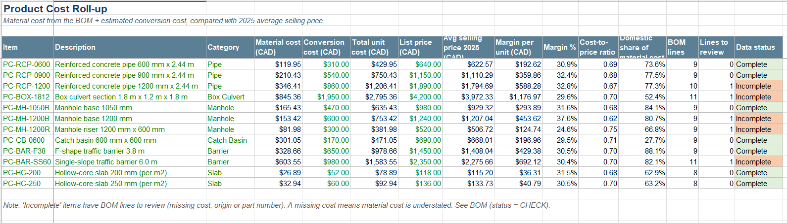
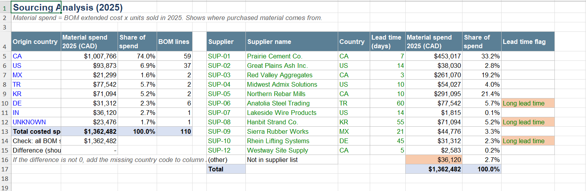
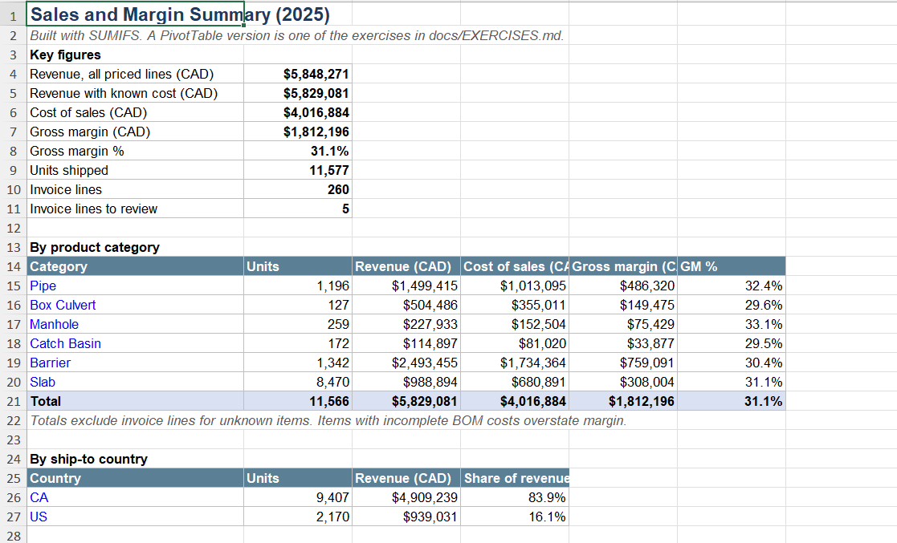

# Precast Cost and Sourcing Analysis

An Excel-based analysis that connects **products, bills of materials (BOMs), suppliers and sales**
for a fictional precast concrete manufacturer, *Northfield Precast Ltd.*

It answers three practical questions:

1. **What does each product cost to make**, and how does that compare with its selling price?
2. **Where does purchased material come from**, by country and by supplier?
3. **Which data is missing or inconsistent**, and what needs to be followed up?

> **Data note:** all data in this repository is synthetic (invented) and created by
> `scripts/generate_data.py`. Company, supplier and customer names are fictional.
> HS codes are illustrative only.

---

## Key results (2025 synthetic data)

| Measure | Result |
|---|---|
| Revenue (priced invoice lines) | about $5.85 M CAD |
| Gross margin | about 31 % |
| Lowest-margin product | Manhole riser 1200 mm (about 25 %) |
| Material spend from domestic (Canadian) suppliers | about 74 % |
| Spend with long-lead-time suppliers (> 30 days) | about 13 % |
| Products with BOM lines needing review | 5 of 12 |
| Data quality checks | 15 checks; 17 issues flagged, plus 2 for information |

The workbook recalculates all of these if an input or assumption changes.

---

## Workbook structure

`workbook/Precast_Cost_Analysis.xlsx`

| Sheet | Purpose |
|---|---|
| About | Guide to the workbook and colour legend |
| Assumptions | Exchange rates, unit conversions, thresholds, key assumptions |
| Items | Finished products, list prices, conversion costs, HS codes |
| Suppliers | Supplier list with country and lead time |
| Components | Purchased materials and parts with cost, supplier and origin |
| BOM | BOM lines with lookups, unit conversion, extended cost and issue flags |
| Sales | 2025 invoice lines with revenue, discount and cost of sales |
| Cost_Rollup | Unit cost vs. average selling price, margin, cost-to-price ratio |
| Sourcing | Material spend by origin country and by supplier, with reconciliation |
| Summary | Revenue and margin by category and ship-to country |
| Data_Quality | 15 automated checks with severity and suggested action |
| Open_Questions | Log of questions to resolve with other teams |

**Colour convention:** blue text = input, black = formula, green = link to another sheet,
yellow fill = key assumption. Dark-blue headers are raw columns; grey-blue headers are
calculated columns.

### Screenshots

**Product cost roll-up:** unit cost, selling price, margin and data status for each product


**Sourcing:** 2025 material spend by origin country and by supplier, with reconciliation checks


**Data quality:** automated checks with severity and suggested action


---

## Method

1. **Standardise keys.** Codes are cleaned with `TRIM` and `UPPER` before matching, so
   `"rb-15m "` and `"RB-15M"` are treated as the same component.
2. **Look up component data** (cost, unit, origin, supplier) for each BOM line with `XLOOKUP`,
   using its *if not found* argument to flag missing codes instead of hiding errors.
3. **Convert units** when the BOM unit differs from the purchase unit (for example LB to KG),
   using a conversion table on the Assumptions sheet.
4. **Convert costs to CAD** using the exchange-rate table.
5. **Roll up** material cost per product with `SUMIFS`, add conversion cost, and compare
   with the 2025 average selling price.
6. **Weight by volume:** material spend = BOM extended cost × units sold in 2025.
7. **Flag issues** on each row, count them on `Data_Quality`, and record follow-up
   questions on `Open_Questions`.
8. **Reconcile:** the Sourcing sheet checks that spend by country and by supplier both add
   back to the total.

Missing values are never replaced with zero. A line with no cost is left out of the total
and the product is marked **Incomplete**, so understated costs are visible.

---

## Data quality issues included on purpose

The raw data contains realistic problems so the checks can be demonstrated:

- Missing unit cost, missing country of origin, missing HS code
- HS code in the wrong format
- Duplicate component code (different case and a trailing space)
- Component linked to a supplier that is not in the supplier list
- BOM line with a part number that does not exist
- BOM quantity entered in pounds instead of kilograms
- Invoice lines with no price, an unknown item, or a large discount

---

## Repository layout

```
precast-cost-sourcing-analysis/
├── data/raw/            Synthetic CSV files (items, suppliers, components, bom, sales_2025)
├── workbook/            Precast_Cost_Analysis.xlsx
├── powerquery/          Power Query (M) code for loading and cleaning the CSV files
├── scripts/             generate_data.py, build_workbook.py
├── docs/                EXERCISES.md, screenshots/
├── CHANGELOG.md
└── README.md
```

## Rebuild from scratch

Requires Python 3.10 or later.

```bash
pip install -r requirements.txt
python scripts/generate_data.py     # creates data/raw/*.csv
python scripts/build_workbook.py    # creates workbook/Precast_Cost_Analysis.xlsx
```

Open the workbook in Excel; formulas calculate when the file opens.

The workbook uses `XLOOKUP`, which needs Excel 2021 or Microsoft 365. For older Excel versions
or LibreOffice, build an `INDEX/MATCH` version instead:

```bash
python scripts/build_workbook.py --compat
```

> **Note:** running the build script replaces `workbook/Precast_Cost_Analysis.xlsx`. If you have
> added your own sheets or queries in Excel, save a copy first.

## Power Query

The `powerquery/` folder holds M code that repeats the main cleaning steps with Power Query:
loading the CSV files, setting data types, standardising codes, joining BOM lines to components
(left join, so unmatched lines stay visible), converting units and currencies, and removing
duplicate components.

`docs/EXERCISES.md` explains how to load the queries into Excel and extend the analysis
with a PivotTable.

---

## Skills demonstrated

- Excel: `XLOOKUP`, `SUMIFS`, `COUNTIFS`, `SUMPRODUCT`, named ranges, conditional formatting
- Power Query (M): type conversion, merges (joins), grouping, de-duplication
- Bill of materials costing, margin and cost-to-price analysis
- Supplier and country-of-origin analysis
- Data validation, reconciliation and issue tracking
- Clear documentation of sources, assumptions and open questions
- Reproducible data generation with Python and version control with Git

## Possible next steps

- Add a cost history so changes in material prices can be tracked over time
- Add a what-if table for exchange-rate changes
- Connect the queries to a live data source instead of CSV files

---

Author: [Nidhi Nalini Nand](https://github.com/NidhiNalini) · Licence: MIT
